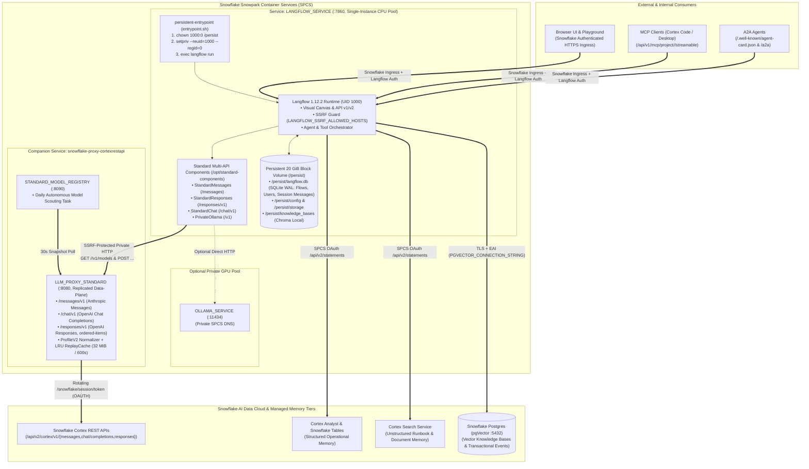
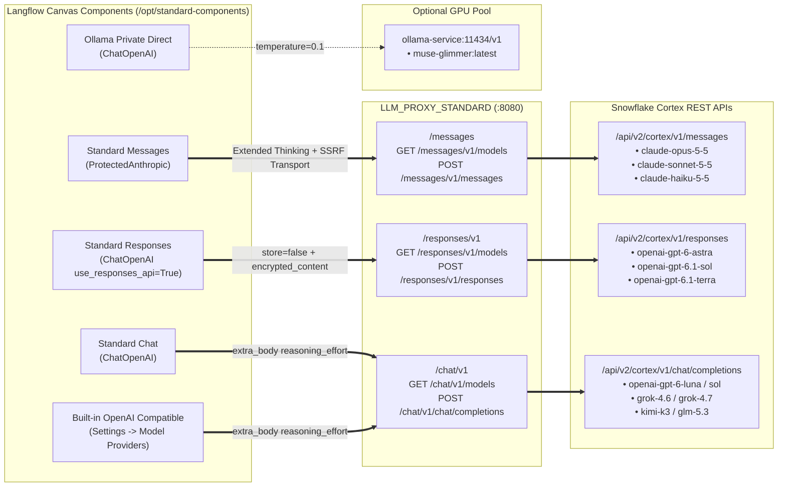
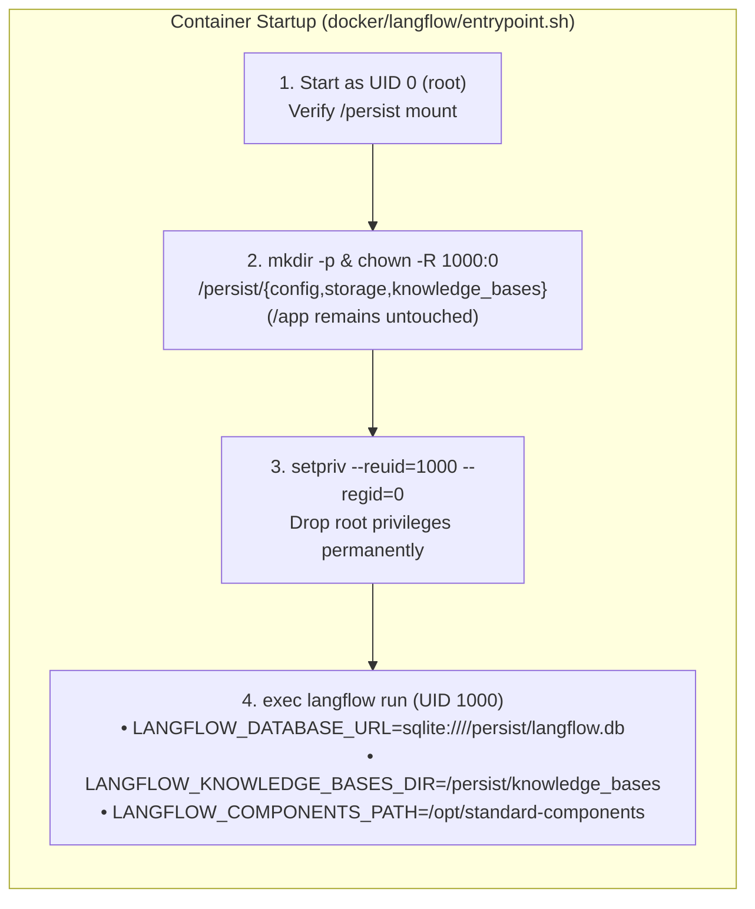
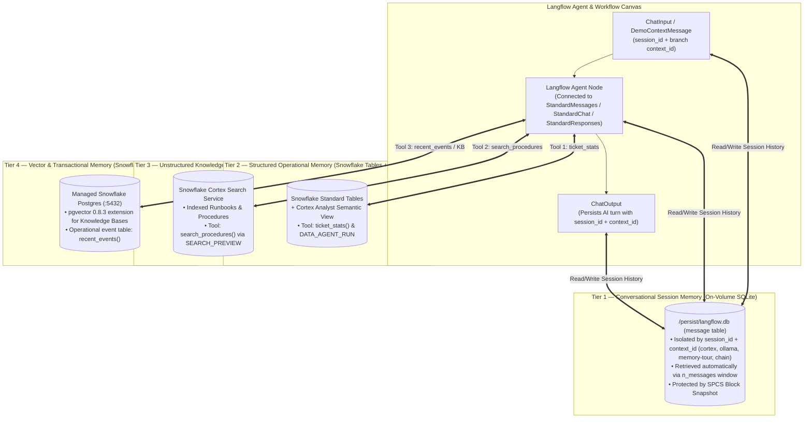
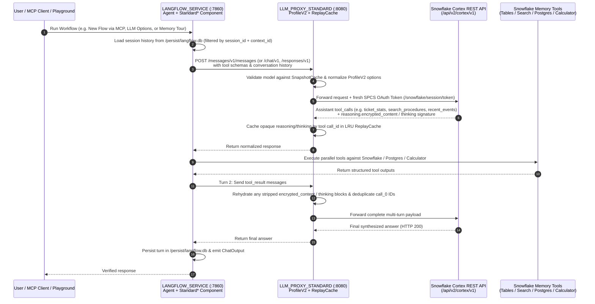

<div align="center">

# Langflow on Snowflake (SPCS) — Out-of-the-Box Deployment Kit

**Enterprise-Ready Adaptation of Upstream [Langflow](https://www.langflow.org) on Snowflake Snowpark Container Services (SPCS) with Multi-API Cortex Proxy Integration (`Messages` | `Chat` | `Responses`), Persistent Block Storage, Multi-Tier Agentic Memory (`SQLite` + `pgVector` + `Cortex Search` + `Cortex Analyst`) & Passwordless GitHub OIDC**

[](LICENSE)
[](https://docs.snowflake.com/en/developer-guide/snowpark-container-services/overview)
[](https://github.com/fbattaglieri-snowflake/snowflake-proxy-cortexrestapi)
[](#3-multi-api-protocol-routing--standard-components)
[](#8-quickstart--local-validation)

</div>

---

> [!WARNING]
> ### IMPORTANT DISCLAIMER — NOT AN OFFICIAL SNOWFLAKE OR LANGFLOW PRODUCT
> **This repository is an independent, open-source community and field-engineering deployment kit** built on top of public **Snowflake Snowpark Container Services (SPCS)**, **Snowflake Cortex REST APIs**, and upstream **Langflow OSS**.
> - It is **NOT an official Snowflake Inc. or Langflow product**, integration, reference architecture, certification, or commercial support offering.
> - Neither **Snowflake Inc.** nor the **Langflow** project or its maintainers endorse, sponsor, or warrant this repository.
> - Provided strictly **"AS IS"**, at your own risk. Read [DISCLAIMER.md](DISCLAIMER.md), [SECURITY.md](SECURITY.md), [NOTICE](NOTICE), and [docs/validation.md](docs/validation.md) before deploying.

> [!IMPORTANT]
> ### CORE ARCHITECTURAL DEPENDENCY — [`snowflake-proxy-cortexrestapi`](https://github.com/fbattaglieri-snowflake/snowflake-proxy-cortexrestapi)
> To unlock the complete **Snowflake Cortex REST API** surface (**Anthropic Messages** `/messages`, **OpenAI Chat Completions** `/chat/v1`, and **OpenAI Responses** `/responses/v1`) with live dynamic model discovery, `ProfileV2` parameter normalization, `ordered-items` SSE streaming, stateless `ReplayCache` reasoning rehydration, and zero-touch daily model promotion, this deployment integrates natively with:
> - **Primary Shared Multi-API Proxy (Recommended):** [**`fbattaglieri-snowflake/snowflake-proxy-cortexrestapi`**](https://github.com/fbattaglieri-snowflake/snowflake-proxy-cortexrestapi) (`LLM_PROXY_STANDARD` `:8080` + `STANDARD_MODEL_REGISTRY` `:8090`)
> - **Model Qualification Harness:** [**`fbattaglieri-snowflake/cortex-model-compatibility-matrix`**](https://github.com/fbattaglieri-snowflake/cortex-model-compatibility-matrix)
> - **Bundled Single-Endpoint Fallback:** This repository also includes a minimal standalone Chat Completions adapter (`proxy/server.py`) for single-protocol non-streaming deployments.

---

## Table of Contents

1. [Executive Overview & Why This Adaptation Exists](#1-executive-overview--why-this-adaptation-exists)
2. [End-to-End SPCS System Architecture (Visual Schematics)](#2-end-to-end-spcs-system-architecture)
3. [Multi-API Protocol Routing & `Standard*` Components (`Messages` / `Chat` / `Responses`)](#3-multi-api-protocol-routing--standard-components)
4. [Persistent Block Storage (`setpriv` Root-to-UID-1000) & Multi-Tier Memory Architecture](#4-persistent-block-storage--multi-tier-memory-architecture)
5. [Multi-Turn Agent Tool Loop & Stateless Reasoning Replay](#5-multi-turn-agent-tool-loop--stateless-reasoning-replay)
6. [Prerequisites & Cross-Region Inference (`ANY_REGION`)](#6-prerequisites--cross-region-inference-any_region)
7. [Step-by-Step Deployment Guide & GitHub Actions OIDC](#7-step-by-step-deployment-guide--github-actions-oidc)
8. [Quickstart & Local Validation](#8-quickstart--local-validation)
9. [Repository Structure & Documentation Index](#9-repository-structure--documentation-index)

---

## 1. Executive Overview & Why This Adaptation Exists

Deploying upstream **Langflow** out-of-the-box inside **Snowflake Snowpark Container Services (SPCS)** — while preserving unmodified upstream visual canvas workflows, session memories, MCP/A2A endpoints, and connecting to **Snowflake Cortex AI** across all model families — requires solving six concrete platform and protocol barriers:

| # | SPCS / Cortex Integration Challenge | What Happens with Unmodified Upstream Defaults | How `langflow-snowflake` Solves It |
|---|---|---|---|
| **1** | **Three Distinct Cortex REST API Surfaces** | Claude models require **Anthropic Messages** (`/api/v2/cortex/v1/messages`), frontier OpenAI reasoning models (`gpt-6-astra`, `gpt-6.1-sol`, `gpt-6.1-terra`) require **OpenAI Responses** (`/api/v2/cortex/v1/responses`), and chat models (`gpt-6-luna`, `gpt-6-sol`, `grok-4.6/4.7`, `kimi-k3`, `glm-5.3`) require **Chat Completions** (`/api/v2/cortex/v1/chat/completions`). | Ships `standard_langflow.py` + four dedicated canvas components under `/opt/standard-components` (**`Standard Messages`**, **`Standard Responses`**, **`Standard Chat`**, **`Ollama Private Direct`**) plus built-in **`OpenAI Compatible`** support pointing to `LLM_PROXY_STANDARD` `:8080`. |
| **2** | **SPCS Rotating OAuth Token vs Static API Keys** | SPCS rotates `/snowflake/session/token` on disk and requires `X-Snowflake-Authorization-Token-Type: OAUTH`, while Langflow components pass a static `api_key`. | Internal requests terminate at **`LLM_PROXY_STANDARD`** (`snowflake-proxy-cortexrestapi`) over private SPCS DNS, which injects the fresh OAuth token on every upstream request without exposing credentials in flows. |
| **3** | **Client Parameter & Reasoning Conflicts (`HTTP 400`)** | `ChatOpenAI` rejects top-level `reasoning_effort` (`extra_forbidden`), `gpt-6-luna`/`sol` require `reasoning_effort="none"` with tools, `grok`/`kimi`/`glm` reject `reasoning_effort`, and Responses requires `store=false` + `include=["reasoning.encrypted_content"]`. | `standard_langflow.resolve_reasoning_options()` + proxy `ProfileV2` normalization automatically route `reasoning_effort` via `extra_body`, enforce `store=false`, clamp token budgets (`1..128000`), and support Anthropic Extended Thinking. |
| **4** | **Block Volume Root Ownership vs `UID 1000`** | SPCS mounts block volumes (`source: block`) owned by `root:root` (`uid/gid` in service specs apply only to stage volumes), while upstream Langflow runs as `uid=1000`, causing SQLite WAL/journal writes to fail. | `docker/langflow/entrypoint.sh` starts as `root`, initializes and `chown 1000:0` **only** `/persist` (`config`, `storage`, `knowledge_bases`), and drops privileges to `UID 1000` via `setpriv` before starting `langflow run`. |
| **5** | **Ephemeral Knowledge Bases & Vector Memory** | Upstream Langflow writes local Chroma knowledge bases to `~/.langflow/knowledge_bases` (`/app/data` outside `/persist`) and lacks the `pgvector` Python extra in the default image. | Sets `LANGFLOW_KNOWLEDGE_BASES_DIR=/persist/knowledge_bases`, installs `pgvector` in `docker/langflow/Dockerfile`, and wires `PGVECTOR_CONNECTION_STRING` to managed **Snowflake Postgres (`pgVector`)**. |
| **6** | **SSRF Protection vs Private SPCS Service DNS** | Upstream Langflow SSRF protection blocks internal `.svc.spcs.internal` endpoints unless explicitly allowlisted, and upstream Anthropic `get_models()` ignores custom base URLs. | Configures `LANGFLOW_SSRF_ALLOWED_HOSTS` strictly for the internal proxy/Ollama DNS hosts and uses `lfx.base.models.provider_ssrf.provider_httpx_clients` in `standard_langflow.py` (`ProtectedAnthropic` + `ChatOpenAI`) for both live catalog discovery (`Refresh`) and inference. |

---

## 2. End-to-End SPCS System Architecture



### ASCII Architecture Quick-Reference

```text
+---------------------------------------------------------------------------------------------------+
|  CLIENTS: Browser UI / Playground  |  MCP Clients (stdio/SSE)  |  A2A Agents                      |
+-------------------------------------------------+-------------------------------------------------+
                                                  |  Snowflake HTTPS Ingress + Langflow API Key/Login
                                                  v
+---------------------------------------------------------------------------------------------------+
|  SPCS SERVICE: LANGFLOW_SERVICE (:7860, UID 1000 after entrypoint.sh setpriv transition)          |
|  +----------------------------------------------+----------------------------------------------+  |
|  | Persistent Block Volume (/persist — 20 GiB)  | Native Standard Components (standard_langflow|  |
|  | • /persist/langflow.db (SQLite: Flows &      | • Standard Messages  ──> /messages           |  |
|  |   Session Message History by context_id)     | • Standard Responses ──> /responses/v1       |  |
|  | • /persist/knowledge_bases (Local KBs)       | • Standard Chat      ──> /chat/v1            |  |
|  | • Snapshot-backed (snapshotOnDelete: 7d)     | • Ollama Direct      ──> ollama:11434/v1     |  |
|  +----------------------------------------------+----------------------------------------------+  |
+------------------------+-------------------------------------------------+------------------------+
                         |                                                 |
       Private SPCS DNS (SSRF Allowlisted)                   SPCS OAuth + TLS EAI (Memory Tiers)
                         |                                                 |
                         v                                                 v
+------------------------------------------------+   +----------------------------------------------+
|  snowflake-proxy-cortexrestapi (:8080 / :8090) |   |  SNOWFLAKE MULTI-TIER AGENT MEMORY           |
|  • LLM_PROXY_STANDARD + STANDARD_MODEL_REGISTRY|   |  1. SQLite (/persist/langflow.db session msg)|
|  • Injects /snowflake/session/token (OAUTH)    |   |  2. Snowflake Tables + Cortex Analyst        |
|  • ProfileV2 Normalizer + LRU ReplayCache      |   |  3. Cortex Search (RAG / Runbooks)           |
|  • Daily Autonomous Model Scouting & Promotion |   |  4. Snowflake Postgres (pgVector + Events)   |
+------------------------+-----------------------+   +----------------------------------------------+
                         |
                         v
+------------------------------------------------+
|  SNOWFLAKE CORTEX REST API (/api/v2/cortex/v1) |
|  • POST /messages  • POST /chat/completions    |
|  • POST /responses                             |
+------------------------------------------------+
```

---

## 3. Multi-API Protocol Routing & `Standard*` Components

Different model families on **Snowflake Cortex REST API** require their respective native wire protocol. Attempting to call a Responses-only model on `/chat/completions` or a Claude model without the Anthropic Messages contract leads to `HTTP 400` errors or lost reasoning/tool blocks.

`docker/langflow/standard_langflow.py` and the four components in `docker/langflow/components/standard/` route each model family to its exact reference API on **`LLM_PROXY_STANDARD`**:



### Reference API Matrix in Langflow

| Component / Provider in Langflow | Target Proxy Endpoint | Underlying SDK Class | Key Protocol & Reasoning Guarantees | Active Qualified Models (Example Catalog) |
|---|---|---|---|---|
| **`Standard Messages`** (`Core / standard`) | `${STANDARD_PROXY_ORIGIN}/messages` | `ProtectedAnthropic` (`langchain_anthropic.ChatAnthropic` with SSRF `http_client` / `http_async_client`) | Live catalog via `GET /messages/v1/models`; optional **Extended Thinking** (`thinking={"type": "enabled", "budget_tokens": ...}` with `max_tokens > budget_tokens`); `max_retries=0`. | `claude-haiku-5-5`, `claude-opus-5-5`, `claude-sonnet-5-5` |
| **`Standard Responses`** (`Core / standard`) | `${STANDARD_PROXY_ORIGIN}/responses/v1` | `ChatOpenAI(..., use_responses_api=True)` | Live catalog via `GET /responses/v1/models`; enforces `store=False`, `include=["reasoning.encrypted_content"]`, `output_version="responses/v1"`, and `extra_body={"reasoning": {"effort": ..., "summary": "auto"}}`; supports `ordered-items` streaming. | `openai-gpt-6-astra`, `openai-gpt-6.1-sol`, `openai-gpt-6.1-terra` |
| **`Standard Chat`** (`Core / standard`) | `${STANDARD_PROXY_ORIGIN}/chat/v1` | `ChatOpenAI(..., use_responses_api=False)` | Live catalog via `GET /chat/v1/models`; passes `reasoning_effort` via `extra_body` (avoiding Pydantic `extra_forbidden`), defaults `openai-gpt-6-luna`/`sol` to `"none"`, omits `reasoning_effort` on `grok-4.6/4.7`, `kimi-k3`, `glm-5.3`, and reads live `constraints` for newly promoted models. | `glm-5.3`, `grok-4.6`, `grok-4.7`, `kimi-k3`, `openai-gpt-6-luna`, `openai-gpt-6-sol` |
| **Built-in `OpenAI Compatible`** (`Settings -> Model Providers`) | `${STANDARD_PROXY_ORIGIN}/chat/v1` | Langflow Built-in `LanguageModelComponent` | Configured via `OPENAI_COMPATIBLE_BASE_URL` + placeholder `OPENAI_COMPATIBLE_API_KEY="private-spcs"`. Protected by proxy `ProfileV2` normalization; chat models enabled for `llm` and disabled for `embeddings`. | All 6 `/chat/v1` models |
| **`Ollama Private Direct`** (`Core / standard`) | `${OLLAMA_BASE_URL}/v1` | `ChatOpenAI(..., temperature=0.1)` | Direct private SPCS GPU endpoint without Cortex payload rewrites or Snowflake OAuth headers. | `muse-glimmer:latest` |

---

## 4. Persistent Block Storage & Multi-Tier Memory Architecture

### 4.1 Why Block Storage + `setpriv` Root-to-UID-1000 Transition Is Required

1. **Why Block Storage (Not Stage Volumes) for SQLite:** Upstream Langflow relies on database uniqueness constraints (`IntegrityError` across 53 `UNIQUE` constraints) and random-access WAL/journal writes. SPCS stage mounts reject random writes and `append=True`, whereas an SPCS **20 GiB Block Volume** mounted at `/persist` provides a real POSIX filesystem that survives container restarts, `ALTER SERVICE` upgrades, and `SUSPEND` / `RESUME` cycles.
2. **Why `entrypoint.sh` Drops from `root` to `UID 1000`:** In SPCS, `uid` and `gid` fields in volume specifications apply only to stage volumes; block volumes are mounted owned by `root:root`. `docker/langflow/entrypoint.sh` starts as `UID 0`, ensures `/persist/{config,storage,knowledge_bases}` exists and is owned by `1000:0`, and immediately executes `setpriv --reuid=1000 --regid=0 --init-groups` before launching `langflow run`.



### 4.2 Multi-Tier Agentic Memory in Langflow Workflows

Langflow workflows on Snowflake combine **four complementary memory tiers**, all preserved across upgrades and backed by Snowflake snapshots and PITR:



---

## 5. Multi-Turn Agent Tool Loop & Stateless Reasoning Replay



---

## 6. Prerequisites & Cross-Region Inference (`ANY_REGION`)

### 6.1 Enable Snowflake Cross-Region Inference
Many frontier models on Snowflake Cortex (`claude-opus-5-5`, `claude-sonnet-5-5`, `openai-gpt-6-astra`, `openai-gpt-6.1-sol`, `openai-gpt-6.1-terra`, `openai-gpt-6-luna`, `grok-4.7`, `glm-5.3`) are served via cross-region inference depending on your account's home region:

```sql
USE ROLE ACCOUNTADMIN;
ALTER ACCOUNT SET CORTEX_ENABLED_CROSS_REGION = 'ANY_REGION';
```

### 6.2 Platform Prerequisites
- Snowflake account supporting **Snowpark Container Services (SPCS)**, **Block Volumes**, and CPU compute pools (`CPU_X64_S` or larger).
- Deployed [**`snowflake-proxy-cortexrestapi`**](https://github.com/fbattaglieri-snowflake/snowflake-proxy-cortexrestapi) (`LLM_PROXY_STANDARD` + `STANDARD_MODEL_REGISTRY`) in the same account (Topology A, recommended), or the bundled standalone Chat adapter (`proxy/server.py`, Topology B).
- Snowflake CLI (`snow`), Docker with `linux/amd64` buildx support, Python `3.11+`, and `trivy`.
- Persistent Snowflake Secrets provisioned for `LANGFLOW_SECRET_KEY` (encryption key), `LANGFLOW_SUPERUSER` (admin credentials), and optional `LANGFLOW_PGVECTOR_URL` (Snowflake Postgres TLS connection string).

---

## 7. Step-by-Step Deployment Guide & GitHub Actions OIDC

### Topology A (Recommended): Deployment with Shared Multi-API `snowflake-proxy-cortexrestapi`

1. Deploy [**`fbattaglieri-snowflake/snowflake-proxy-cortexrestapi`**](https://github.com/fbattaglieri-snowflake/snowflake-proxy-cortexrestapi) so `LLM_PROXY_STANDARD` is reachable on internal SPCS DNS (e.g., `http://llm-proxy-standard.<schema>.svc.spcs.internal:8080`).
2. Build and push the persistent Langflow image (`docker/langflow/Dockerfile`), which bundles:
   - `standard_langflow.py` in `/app/.venv/lib/python3.14/site-packages/standard_langflow.py`
   - The four `Standard*` components in `/opt/standard-components/standard/`
   - `persistent-entrypoint` (`docker/langflow/entrypoint.sh`)
3. Set `LANGFLOW_SSRF_ALLOWED_HOSTS` to the internal DNS of `LLM_PROXY_STANDARD` (and optional `OLLAMA_SERVICE`), `LANGFLOW_COMPONENTS_PATH=/opt/standard-components`, and `STANDARD_PROXY_ORIGIN=http://<proxy-dns>:8080`.
4. After `LANGFLOW_SERVICE` reaches `READY`:
   - In the visual canvas sidebar under **Core / standard**, select **`Standard Messages`** (`/messages`), **`Standard Responses`** (`/responses/v1`), **`Standard Chat`** (`/chat/v1`), or **`Ollama Private Direct`**, click **Refresh** on `Published model`, and connect its `Language Model` port to your `Agent` node.
   - Optionally configure **Settings -> Model Providers -> OpenAI Compatible** with Base URL `http://<proxy-dns>:8080/chat/v1` and API Key `private-spcs`.

### Topology B (Standalone Fallback): Deployment with Bundled Single-Endpoint Chat Adapter

Run from a fresh clone using explicit administrator-reviewed configuration:

```sh
python3 -m venv .venv
. .venv/bin/activate
pip install -r requirements-dev.txt
cp infrastructure/config.example.json config.local.json
```

1. Populate `config.local.json` with your target Snowflake identifiers (see [docs/configuration.md](docs/configuration.md)).
2. Generate and review the bootstrap SQL:
   ```sh
   mkdir -p build
   python scripts/deploy.py bootstrap --config config.local.json > build/bootstrap.sql
   snow sql --connection YOUR_ADMIN_CONNECTION --filename build/bootstrap.sql
   ```
3. Provision encryption and login secrets ([infrastructure/sql/10_secret_grants.sql](infrastructure/sql/10_secret_grants.sql)).
4. Build and scan images:
   ```sh
   python scripts/build_images.py --config config.local.json --publish
   ```
5. Deploy or upgrade non-destructively (existing block volumes are preserved via `ALTER SERVICE`):
   ```sh
   python scripts/deploy.py deploy --config config.local.json \
     --catalog build/models.json --apply --allow-create
   ```

---

## 8. Quickstart & Local Validation

Run the complete offline lint and unit test suite locally (requires no Snowflake credentials or network access):

```sh
ruff check scripts proxy tests docker/langflow
python -m pytest -q
```

What the offline test suite verifies (`36/36 PASS`):
- **`tests/test_standard_langflow.py`**: Multi-API protocol routing (`/chat/v1`, `/responses/v1`, `/messages`, `/v1`), `resolve_reasoning_options` (`extra_body` reasoning effort, `store=False`, `reasoning.encrypted_content`, Anthropic Extended Thinking budget auto-adjustment), token range guards (`1..128000`), and live catalog refresh without silent model replacement.
- **`tests/test_deploy.py`**: Portable service spec rendering, SQL identifier injection guards, `LANGFLOW_COMPONENTS_PATH` & `STANDARD_PROXY_ORIGIN` wiring, optional `pgVector` secret/EAI enforcement, non-destructive `ALTER SERVICE` upgrades, and block volume resize protection.
- **`tests/test_proxy.py`**: Bundled fallback adapter OAuth token rotation, `max_tokens` $\rightarrow$ `max_completion_tokens` rewrite, `finish_reason` normalization, parallel tool call preservation, and upstream error redaction.
- **`tests/test_repository.py`**: Immutable 40-char SHA pinning on all GitHub Actions, `workflow_dispatch`-only production deployment gate, blocking vulnerability scan flags, and resolution of all local Markdown links.

---

## 9. Repository Structure & Documentation Index

```text
langflow-snowflake/
├── README.md                                  # Visual architecture & deployment guide
├── DISCLAIMER.md                              # Non-official project legal disclaimer
├── SECURITY.md                                # Security policy & vulnerability reporting
├── LICENSE                                    # Apache-2.0 License
├── docker/
│   └── langflow/
│       ├── Dockerfile                         # Persistent Langflow image + pgvector + Standard components
│       ├── entrypoint.sh                      # Root -> chown /persist -> setpriv UID 1000 transition
│       ├── security-constraints.txt           # Reviewed transitive dependency floors
│       ├── standard_langflow.py               # Multi-API runtime client (/messages, /responses/v1, /chat/v1, /v1)
│       └── components/
│           └── standard/
│               ├── chat.py                    # StandardChat canvas component (/chat/v1)
│               ├── responses.py               # StandardResponses canvas component (/responses/v1)
│               ├── messages.py                # StandardMessages canvas component (/messages)
│               └── ollama.py                  # PrivateOllama canvas component (/v1)
├── proxy/
│   ├── Dockerfile                             # Pinned Alpine container for standalone fallback adapter
│   ├── server.py                              # Minimal non-streaming Chat Completions fallback adapter
│   └── models.example.json                    # Template catalog for standalone fallback adapter
├── infrastructure/
│   ├── config.example.json                    # Account-agnostic deployment configuration schema
│   └── sql/
│       ├── 00_oidc_trust.sql                  # GitHub Actions OIDC workload identity template
│       └── 10_secret_grants.sql               # Least-privilege secret grant template
├── scripts/
│   ├── deploy.py                              # Bootstrap, spec renderer & non-destructive SPCS deployer
│   ├── build_images.py                        # Multi-image builder & Trivy gate
│   ├── smoke_image.py                         # Two-container block persistence & SQLite integrity smoke test
│   └── ci_config.py                           # CI configuration validator
├── docs/
│   ├── architecture.md                        # Multi-API protocol routing & storage architecture
│   ├── configuration.md                       # Configuration keys, secrets & optional pgVector/Ollama
│   ├── operations.md                          # Zero-downtime upgrades, suspend/resume & background polling
│   ├── backup-recovery.md                     # Block volume snapshots, secret recovery & Postgres PITR
│   ├── security.md                            # SSRF allowlisting, EAI boundaries & RBAC model
│   ├── mcp-a2a.md                             # MCP streamable server & A2A agent exposure on SPCS
│   ├── ci-cd.md                               # GitHub Actions CI & passwordless OIDC deployment
│   ├── troubleshooting.md                     # Symptom-to-remediation operational matrix
│   └── validation.md                          # Offline test coverage & security scan disclosures
└── tests/
    ├── test_standard_langflow.py              # Unit tests for multi-API Standard proxy components
    ├── test_deploy.py                         # Unit tests for SPCS spec rendering & upgrade guards
    ├── test_proxy.py                          # Unit tests for standalone fallback adapter
    └── test_repository.py                     # Repository hygiene, SHA pins & markdown link checks
```

### Detailed Documentation Guides
- **[Architecture & Multi-API Protocol Contract](docs/architecture.md)**
- **[Configuration & Secrets Reference](docs/configuration.md)**
- **[Operations, Upgrades & Long-Running Workflows](docs/operations.md)**
- **[Backup, Snapshots & Disaster Recovery](docs/backup-recovery.md)**
- **[Security Boundaries & SSRF Protection](docs/security.md)**
- **[MCP Server & Agent-to-Agent (A2A) Integration](docs/mcp-a2a.md)**
- **[GitHub Actions CI & OIDC Deployment](docs/ci-cd.md)**
- **[Troubleshooting Matrix](docs/troubleshooting.md)**
- **[Validation Status & Security Gate Disclosures](docs/validation.md)**

---

Repository-authored code is licensed under [Apache-2.0](LICENSE); upstream components retain their respective licenses ([NOTICE](NOTICE), [third_party/LANGFLOW_LICENSE](third_party/LANGFLOW_LICENSE)). No live account identifiers, credentials, or private flow exports are distributed in this repository.
