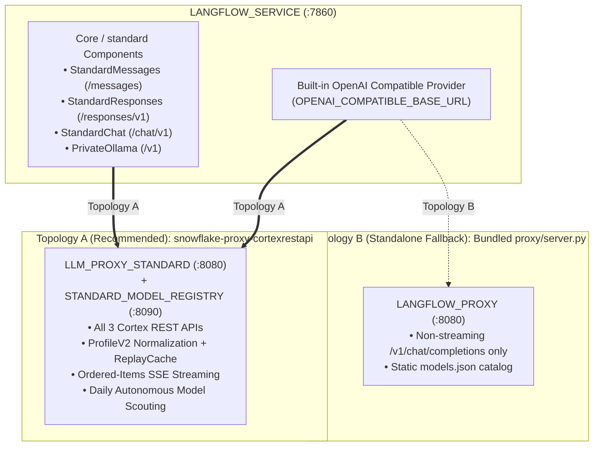

# Architecture & Multi-API Protocol Contract

## 1. Persistent Application Runtime (`docker/langflow/`)

The deployment kit builds on the upstream Langflow `1.12.2` image with:
1. **`persistent-entrypoint` (`docker/langflow/entrypoint.sh`)**: Starts as `root` exclusively to initialize and `chown 1000:0` the `/persist` SPCS block volume (`config`, `storage`, `knowledge_bases`), then permanently drops privileges to `UID 1000` via `setpriv --reuid=1000 --regid=0 --init-groups` before launching `langflow run`.
2. **`pgvector` SQLAlchemy Extra**: Pre-installed in the application venv so Langflow can connect to managed **Snowflake Postgres (`pgVector`)** via `PGVECTOR_CONNECTION_STRING`.
3. **Multi-API Standard Proxy Runtime (`standard_langflow.py`) & Canvas Components (`/opt/standard-components/standard/`)**: Exposes four dedicated canvas components under **Core / standard** (`Standard Messages`, `Standard Responses`, `Standard Chat`, `Ollama Private Direct`) exported via `LANGFLOW_COMPONENTS_PATH=/opt/standard-components`.

---

## 2. Two Supported Proxy Topologies

### Topology A (Recommended): Shared Multi-API [`snowflake-proxy-cortexrestapi`](https://github.com/fbattaglieri-snowflake/snowflake-proxy-cortexrestapi)

When paired with **`LLM_PROXY_STANDARD`** (`STANDARD_PROXY_ORIGIN`), `standard_langflow.py` routes each model family to its native Snowflake Cortex REST API protocol:

| Protocol Key | Proxy Base Path | Upstream Cortex Endpoint | Component Class | Protocol & Reasoning Contract |
|---|---|---|---|---|
| `messages` | `${STANDARD_PROXY_ORIGIN}/messages` | `/api/v2/cortex/v1/messages` | `StandardMessages` (`ProtectedAnthropic`) | Discovers models via `GET /messages/v1/models`; supports optional **Extended Thinking** (`thinking={"type": "enabled", "budget_tokens": ...}` with automatic `max_tokens > budget_tokens`); uses SSRF-protected `http_client` / `http_async_client`. |
| `responses` | `${STANDARD_PROXY_ORIGIN}/responses/v1` | `/api/v2/cortex/v1/responses` | `StandardResponses` (`ChatOpenAI(use_responses_api=True)`) | Discovers models via `GET /responses/v1/models`; enforces `store=False`, `include=["reasoning.encrypted_content"]`, `output_version="responses/v1"`, and `extra_body={"reasoning": {"effort": ..., "summary": "auto"}}`; requires `response_stream == "ordered-items"` when streaming. |
| `chat` | `${STANDARD_PROXY_ORIGIN}/chat/v1` | `/api/v2/cortex/v1/chat/completions` | `StandardChat` (`ChatOpenAI`) | Discovers models via `GET /chat/v1/models`; passes `reasoning_effort` inside `extra_body` (avoiding Pydantic `extra_forbidden`), defaults `openai-gpt-6-luna`/`sol` to `"none"`, omits `reasoning_effort` on `grok-4.6/4.7`, `kimi-k3`, `glm-5.3`, and inspects live catalog `constraints` for newly promoted models. |
| `ollama` | `${OLLAMA_BASE_URL}/v1` | Private SPCS Ollama `/v1/chat/completions` | `PrivateOllama` (`ChatOpenAI`) | Direct private SPCS GPU endpoint (`temperature=0.1`) with zero Snowflake OAuth headers or Cortex payload rewrites. |

In addition, Langflow's built-in **Settings -> Model Providers -> OpenAI Compatible** can be pointed to `${STANDARD_PROXY_ORIGIN}/chat/v1` (with `OPENAI_COMPATIBLE_API_KEY="private-spcs"`), enabling all published `/chat/v1` models for standard `LanguageModelComponent` nodes while keeping them disabled for `embeddings`.

### Topology B (Standalone Fallback): Bundled `proxy/server.py`

For minimal single-protocol deployments that do not run `snowflake-proxy-cortexrestapi`, `proxy/server.py` provides a lightweight non-streaming `/v1/chat/completions` adapter:
- Exposes `/health`, `/v1/models`, and non-streaming `/v1/chat/completions` only.
- Reads `/snowflake/session/token` on every Cortex request and uses the Snowflake-injected `SNOWFLAKE_HOST`.
- Supports per-model `rename_max_tokens` (`max_tokens` $\rightarrow$ `max_completion_tokens`) and `normalize_finish_reason` (`stop` / `tool_calls` / `length`).
- Forwards `ollama` backend entries to the configured private SPCS endpoint without Snowflake tokens.
- Preserves parallel tool call history without collapsing turns.

---

## 3. Identity & Security Model

- **SPCS Service Identity vs Caller's Rights:** SPCS provides the service owner's OAuth token at `/snowflake/session/token`, **not caller's rights**. All UI authors share the container's runtime trust boundary.
- **Two-Layer Authentication:** External requests must pass both **Snowflake Ingress Authentication** and **Langflow Application Login** (`LANGFLOW_AUTO_LOGIN=false`, `LANGFLOW_NEW_USER_IS_ACTIVE=false`).
- **Strict SSRF Allowlisting:** `LANGFLOW_SSRF_ALLOWED_HOSTS` restricts internal connections strictly to the configured proxy and optional Ollama internal DNS hostnames.
